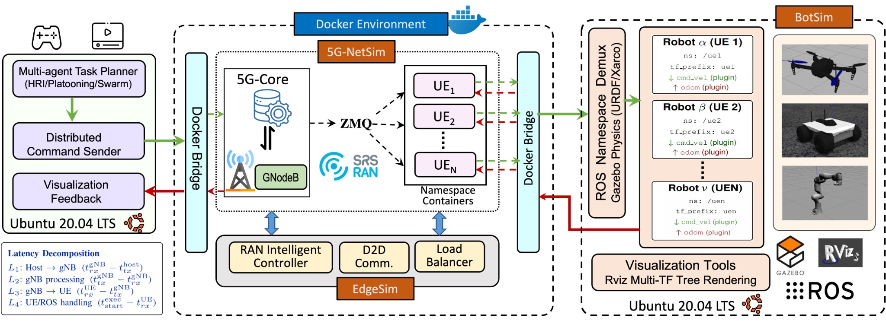

# 5G-NetBotSim

**A Synchronized Intelligent Co-Simulation Framework for Connected Robots over ROS and srsRAN-based 5G Network**

Code and documentation accompanying the paper by **Narges Golmohammadi, Bhaskara Venkata Raju Garuda, Ayan Joshi, and Sabur Baidya** (MSWiM/MobiWac 2026).

5G-NetBotSim couples ROS/Gazebo robotic workloads with an executable cellular communication path and RAN-side edge support. The repository follows the paper's three-component architecture and two experimental workloads.

## Architecture



*5G-NetBotSim architecture: End-to-end command delivery and telemetry feedback framework connecting the host task planner to ROS-enabled simulated multi-robots through srsRAN-based open-source 5G network augmented with edge intelligence.*

| Component | Role in the paper | Repository |
|---|---|---|
| **5G-NetSim** | Executable srsRAN communication path, virtual radio, core and UE processes, and per-UE network isolation | [5G-NetSim/](5G-NetSim/): radio broker, network setup, and external-source integration |
| **EdgeSim** | RAN-side edge intelligence, scheduling, and messaging support | [EdgeSim/](EdgeSim/): component guide and upstream integration map |
| **BotSim** | ROS Noetic/Gazebo robot execution, control, visualization, and per-robot ROS namespaces | [BotSim/](BotSim/): robot applications and custom simulation packages |

Large third-party simulator trees, generated builds and final experiment datasets are external to this compact source release. The paper describes the full framework; availability of each component's implementation is stated in its guide. See [release status](docs/RELEASE_STATUS.md) for the assembled release's validation and radio-mode details.

## Experiments

### 1. Human-to-robot teleoperation

The paper's human-to-robot workload controls a **multi-joint robotic arm** through two command modes:

- **Position/waypoint commands:** six predefined targets, with command delivery, ROS dispatch, queueing, and task-response timing.
- **Velocity-parameterized commands:** motion labels and requested velocities, with interruption/replanning at command intervals of 0.5, 1.0, and 1.5 s.

[Human-to-robot experiments](experiments/human_to_robot/) include the supplied command/timing path and separate guides for the two modes. Full MoveIt execution nodes and velocity-mode experiment scripts are not yet included in this compact release. Ground mobile-robot teleoperation is kept as a supplementary example, rather than presented as the paper's arm experiment.

### 2. Robot-to-robot leader–follower coordination

The paper's robot-to-robot workload uses **two quadrotors**, `robot_alpha` and `robot_beta`. The leader takes off to 2 m and follows nine waypoints. Its position/yaw are transmitted at 10 Hz from UE1 to UE2; the follower uses bounded proportional control to maintain a 2 m world-X offset from the received leader state.

[Robot-to-robot experiments](experiments/robot_to_robot/) connect the supplied drone controllers, cellular bridges, launch package, and tracking plot.

## Experiment videos

| Experiment | Recording |
|---|---|
| Human-to-robot: robotic-arm teleoperation | [Open or download video (MP4, 14.6 MB)](https://github.com/Nargesgoli/5G-NetBotSim/raw/refs/heads/main/experiments/human_to_robot/Humon_robot.mp4) |
| Robot-to-robot: quadrotor coordination | [Open or download video (MP4, 25.0 MB)](https://github.com/Nargesgoli/5G-NetBotSim/raw/refs/heads/main/experiments/robot_to_robot/robot_robot.mp4) |

GitHub's file page may report that these files are too large to preview. The links above open the raw recordings; depending on your browser, they may play directly or download. If a video downloads, open it in a local media player. See [video access and maintenance](docs/VIDEO_UPLOAD.md).

## Getting started

1. Read [installation and external dependencies](docs/INSTALLATION.md).
2. Review [5G-NetSim](5G-NetSim/), [EdgeSim](EdgeSim/), and [BotSim](BotSim/).
3. Follow [network startup and connectivity checks](docs/NETWORK_SETUP.md).
4. Select [human-to-robot](docs/HUMAN_TO_ROBOT.md) or [robot-to-robot](docs/ROBOT_TO_ROBOT.md).
5. Use the paper's [measurement definitions](docs/MEASUREMENTS.md) and record the actual trial configuration.

The guides distinguish commands available in this source subset from missing experiment assets. Reading/presenting the repository does not require installing the simulators.

## Repository layout

| Path | Purpose |
|---|---|
| `5G-NetSim/` | Virtual-radio broker and network component guide |
| `EdgeSim/` | RAN-side edge intelligence and scheduling integration guide |
| `BotSim/human_to_robot/` | Robotic-arm application integration and availability map |
| `BotSim/robot_to_robot/` | Quadrotor telemetry, UE adapters, and follower control |
| `BotSim/workspaces/` | Custom ROS/Gazebo packages; third-party simulator dependencies external |
| `BotSim/examples/` | Supplementary ground teleoperation and velocity-replay examples |
| `experiments/human_to_robot/` | Position/velocity protocol guides and command timing scripts |
| `experiments/robot_to_robot/` | Quadrotor coordination workflow and tracking plot |
| `scripts/`, `config/` | Launch wrappers and endpoint settings |
| `docs/`, `tests/` | Setup, paper-to-code map, measurement definitions, and integration checks |

## Measurements

The paper separates host-to-gNB transfer (L1), gNB processing (L2), gNB-to-UE delivery (L3), UE-to-ROS dispatch (L4), and robot execution (L5). Delivery latency is L1 + L2 + L3; task response includes L4 and L5 when execution events are available. The compact timing utilities currently cover L1–L3. See [measurements](docs/MEASUREMENTS.md) for the distinction between the paper's tracking error and the supplied follower's received-reference log.

## Checks

```bash
python3 -m unittest discover -s tests -v
```

Eight integration checks cover packet/port agreement, stale-state rejection, namespace failure handling, launcher arguments, local UDP capture, and plotting input behavior. They do not require a running radio or ROS simulator; optional plotting checks skip without their dependencies.

## Paper and citation

**5G-NetBotSim: A Synchronized Intelligent Co-Simulation Framework for Connected Robots over ROS and srsRAN-based 5G Network.**

Final proceedings metadata, DOI, and paper links will be added after verification. `CITATION.cff` identifies this software repository. [Paper-to-code map](docs/PAPER_TO_CODE.md) lists the corresponding components, workloads, and release coverage.

## Attribution and licensing

The network dependency builds on [EdgeRIC](https://github.com/ucsdwcsng/EdgeRIC-A-real-time-RIC); quadrotor simulation uses Hector Quadrotor. See [THIRD_PARTY.md](THIRD_PARTY.md) and [LICENSE.md](LICENSE.md) for retained credits and licensing status.
