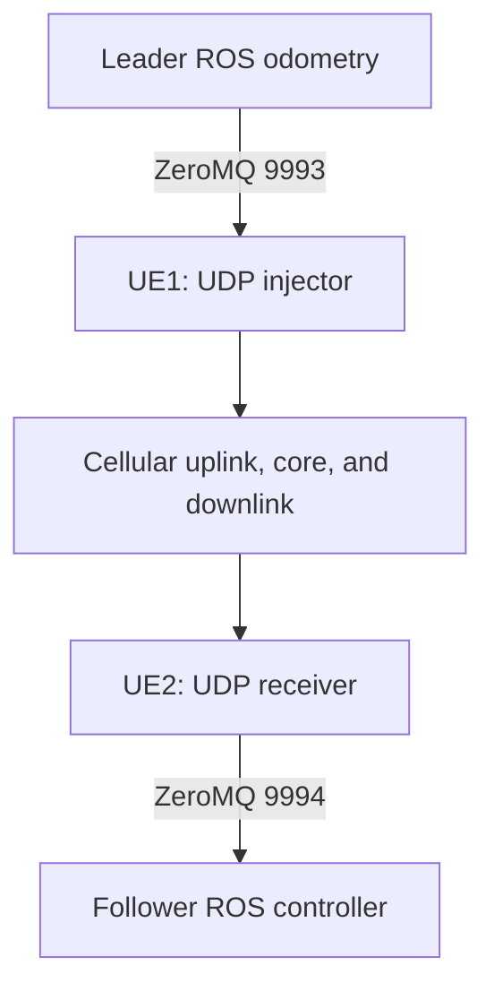

# 5G-NetBotSim

**ROS robot applications connected through software-defined cellular co-simulation.**

Initial code and documentation release accompanying the 5G-NetBotSim paper by **Narges Golmohammadi, Bhaskara Venkata Raju Garuda, Ayan Joshi, and Sabur Baidya**.

This repository shares robot communication bridges, controllers, the two-UE radio broker, custom Gazebo launch packages, measurement utilities, and setup guidelines. Large third-party simulator trees, generated builds, recordings, and final experiment datasets are external to this compact release.


## Framework

| Component | Role | Included here |
|---|---|---|
| Network simulation | Software radio, core network, and UE namespaces | GNU Radio broker and launch wrappers; network dependency fetched separately |
| RAN control | Scheduling and network-side messaging | Provided by the external upstream stack |
| Robot simulation | ROS/Gazebo robots and application control | Ground/drone bridges and custom simulation packages |

For the drone example, the host broadcasts leader position and yaw at 10 Hz. UE1 injects the state into the cellular path; UE2 forwards it to a follower controller. The follower target is 2 m behind the received leader position along the world X axis.



The project name follows the paper. The current dependency snapshot starts an **LTE eNodeB/EPC**. Validated 5G NR operation and the final paper-to-implementation mapping remain to be confirmed for this release.

## Guides

- [Installation and external dependencies](docs/INSTALLATION.md)
- [Network startup and connectivity checks](docs/NETWORK_SETUP.md)
- [Drone leader–follower workflow](docs/DRONE_EXPERIMENT.md)
- [Ground robot examples](docs/GROUND_EXPERIMENT.md)
- [Packet formats and measurements](docs/MEASUREMENTS.md)
- [Validation status and limitations](docs/RELEASE_STATUS.md)

You can read and present this repository without installing the simulators. Running an experiment requires the dependencies and connectivity checks in the guides.

## Source layout

| Folder | Contents |
|---|---|
| `5G-NetSim/` | Supplied two-UE GNU Radio broker |
| `BotSim/drone_network/` | Leader telemetry, UE bridges, follower control |
| `BotSim/teleoperation/` | Ground robot commands and ROS bridges |
| `BotSim/leader_follower/` | Separate ground velocity-replay example |
| `BotSim/workspaces/` | Custom ground and quadrotor ROS packages only |
| `experiments/` | Latency collectors and plotting tools |
| `scripts/` | Application, ROS, and network wrappers |
| `config/` | Example host/container endpoint settings |
| `tests/` | Checks that require no running radio or ROS simulator |
| `docs/` | Setup, metrics, limitations, and original startup references |

## Local checks

```bash
python3 -m unittest discover -s tests -v
```

Eight integration checks passed during preparation. They cover routing/port agreement, stale-packet rejection, namespace permission handling, launcher arguments, local UDP-to-CSV capture, and plotting inputs. Optional plot checks skip when their dependencies are absent. These are not live radio or Gazebo tests.

## Paper and citation

**5G-NetBotSim: A Synchronized Intelligent Co-Simulation Framework for Connected Robots over ROS and srsRAN-based 5G Network** — Narges Golmohammadi, Bhaskara Venkata Raju Garuda, Ayan Joshi, and Sabur Baidya; MSWiM/MobiWac 2026.

Final proceedings metadata, DOI, and paper/video links will be added after verification. `CITATION.cff` currently identifies the software repository rather than a final proceedings citation.

## Attribution and licensing

The external network dependency is based on [EdgeRIC](https://github.com/ucsdwcsng/EdgeRIC-A-real-time-RIC). Quadrotor simulation uses Hector Quadrotor. Original source credits are retained. See [THIRD_PARTY.md](THIRD_PARTY.md) and [LICENSE.md](LICENSE.md). Project-facing naming does not change upstream authorship.
